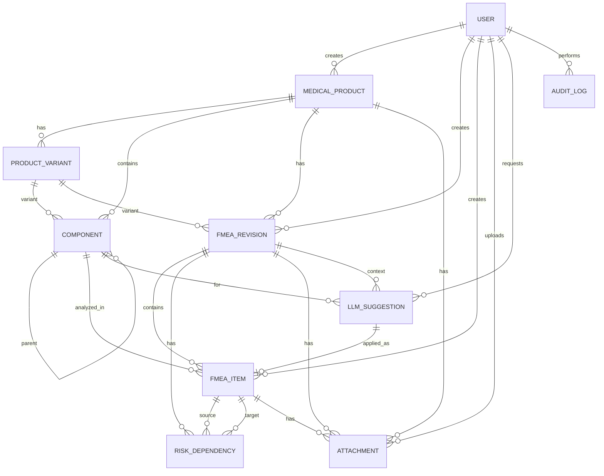

# 02. Доменная модель

## 1. Обзор

Домен строится вокруг изделия, его структуры и версионных FMEA-ревизий. Компоненты изделия анализируются в пунктах FMEA; пункты связываются направленными зависимостями для графа; вложения и LLM-предложения привязаны к изделию, ревизии или компоненту.

Основные сущности:
`User`, `MedicalProduct`, `ProductVariant`, `Component`, `FMEARevision`, `FMEAItem`, `RiskDependency`, `Attachment`, `LLMSuggestion`, `AuditLog`.

## 2. ER-диаграмма



## 3. Перечисления

| Перечисление | Значения |
|---|---|
| `Role` | `engineer`, `quality`, `admin` |
| `ProductStatus` | `active`, `archived` |
| `Criticality` | `low`, `medium`, `high`, `critical` |
| `RevisionStatus` | `draft`, `review`, `approved`, `archived` |
| `ItemStatus` | `open`, `in_progress`, `done`, `accepted` |
| `ItemSource` | `manual`, `llm` |
| `DependencyType` | `causes`, `affects`, `mitigates` |
| `SuggestionStatus` | `new`, `applied`, `rejected` |
| `ActionPriority` | `low`, `medium`, `high`, `critical` |

## 4. Сущности

### 4.1 User

Пользователь системы. Аутентификация по email, пароль хранится в виде хеша Django.

| Поле | Тип | Ограничения | Описание |
|---|---|---|---|
| `id` | bigint | PK | Идентификатор |
| `email` | varchar(254) | unique, not null | Логин |
| `password` | varchar(128) | not null | Хеш пароля |
| `full_name` | varchar(255) | not null | ФИО |
| `role` | enum `Role` | not null, default `engineer` | Роль |
| `position` | varchar(255) | blank | Должность |
| `is_active` | boolean | default true | Активность |
| `last_login` | timestamptz | null | Последний вход |
| `created_at` | timestamptz | auto | Создан |

Правила:
- email приводится к нижнему регистру и уникален без учёта регистра.
- Пользователь с утверждёнными ревизиями не удаляется, а деактивируется.
- Смена роли доступна только администратору.

### 4.2 MedicalProduct

Изделие медицинского назначения.

| Поле | Тип | Ограничения | Описание |
|---|---|---|---|
| `id` | bigint | PK | Идентификатор |
| `code` | varchar(100) | unique, not null | Обозначение, например `АМНК.941629.001ТУ` |
| `name` | varchar(255) | not null | Наименование |
| `manufacturer` | varchar(255) | not null | Изготовитель |
| `tu_code` | varchar(100) | blank | Обозначение ТУ |
| `description` | text | blank | Назначение и особенности |
| `status` | enum `ProductStatus` | default `active` | Статус |
| `created_by` | FK `User` | not null, protect | Автор |
| `created_at` | timestamptz | auto | Создан |
| `updated_at` | timestamptz | auto | Изменён |

Правила:
- Изделие с ревизиями не удаляется, а переводится в `archived`.
- Код изделия уникален.

### 4.3 ProductVariant

Исполнение изделия с отличающимися параметрами.

| Поле | Тип | Ограничения | Описание |
|---|---|---|---|
| `id` | bigint | PK | Идентификатор |
| `product_id` | FK `MedicalProduct` | not null, cascade | Изделие |
| `code` | varchar(100) | not null | Обозначение исполнения |
| `name` | varchar(255) | not null | Название |
| `settings` | jsonb | default `{}` | Параметры: температуры, влажность, поток |
| `is_default` | boolean | default false | Исполнение по умолчанию |
| `created_at` | timestamptz | auto | Создан |

Ограничения:
- `unique(product_id, code)`.
- В рамках изделия только одно исполнение может быть `is_default`.

Пример `settings`:
```json
{
  "output_temperature_c": [28, 38],
  "heater_temperature_c": null,
  "humidity_percent": [50, 75, 100],
  "flow_l_min": [2, 50],
  "warmup_min": 20,
  "mtbf_h": 2000,
  "chamber_volume_ml": 150,
  "leak_ml_min_at_80_pa": 10,
  "power_w": 210,
  "ip_rating": "IPX1"
}
```

### 4.4 Component

Компонент или функциональный узел изделия. Поддерживает иерархию.

| Поле | Тип | Ограничения | Описание |
|---|---|---|---|
| `id` | bigint | PK | Идентификатор |
| `product_id` | FK `MedicalProduct` | not null, cascade | Изделие |
| `variant_id` | FK `ProductVariant` | null, set null | Исполнение, если компонент специфичен |
| `parent_id` | FK `Component` | null, protect | Родительский узел |
| `code` | varchar(100) | not null | Обозначение |
| `name` | varchar(255) | not null | Наименование |
| `component_type` | varchar(100) | blank | Тип: механический, электрический, ПО и т.п. |
| `description` | text | blank | Назначение |
| `criticality` | enum `Criticality` | default `medium` | Критичность |
| `is_active` | boolean | default true | Активен |
| `created_at` | timestamptz | auto | Создан |
| `updated_at` | timestamptz | auto | Изменён |

Ограничения:
- `unique(product_id, variant_id, code)` с `NULLS NOT DISTINCT` (PostgreSQL 15+).
- `parent_id != id`.
- Родитель принадлежит тому же изделию.
- Удаление запрещено, если есть `FMEAItem`; используется архивирование.

### 4.5 FMEARevision

Версия FMEA-таблицы для изделия и исполнения.

| Поле | Тип | Ограничения | Описание |
|---|---|---|---|
| `id` | bigint | PK | Идентификатор |
| `product_id` | FK `MedicalProduct` | not null, cascade | Изделие |
| `variant_id` | FK `ProductVariant` | null, set null | Исполнение |
| `version` | varchar(20) | not null | Версия, например `1.0` |
| `status` | enum `RevisionStatus` | default `draft` | Статус |
| `based_on_id` | FK `FMEARevision` | null, set null | Ревизия-основа |
| `change_reason` | text | blank | Причина изменения |
| `created_by` | FK `User` | not null, protect | Автор |
| `approved_by` | FK `User` | null, protect | Утвердивший |
| `approved_at` | timestamptz | null | Дата утверждения |
| `created_at` | timestamptz | auto | Создана |
| `updated_at` | timestamptz | auto | Изменена |

Ограничения:
- `unique(product_id, variant_id, version)` с `NULLS NOT DISTINCT`.
- `approved_by` и `approved_at` заполняются одновременно.
- `based_on_id` не может ссылаться на саму ревизию.

Переходы статусов:

```text
draft --submit--> review --approve--> approved --archive--> archived
  ^                  |
  |-----reject-------|
```

| Переход | Кто | Условие |
|---|---|---|
| `draft -> review` | engineer, quality | Есть хотя бы один пункт FMEA |
| `review -> draft` | quality, admin | Причина отклонения заполнена |
| `review -> approved` | quality, admin | Нет пустых обязательных полей, S/O/D валидны |
| `approved -> archived` | admin | Ревизия больше не используется |
| `draft -> archived` | admin | Отмена черновика |

Правила:
- В `approved` ревизия доступна только для чтения.
- Новая ревизия создаётся клонированием предыдущей; пункты, компоненты и связи копируются.
- Одновременно у изделия может быть несколько черновиков, но только одна утверждённая ревизия на исполнение.

### 4.6 FMEAItem

Строка FMEA-таблицы.

| Поле | Тип | Ограничения | Описание |
|---|---|---|---|
| `id` | bigint | PK | Идентификатор |
| `revision_id` | FK `FMEARevision` | not null, cascade | Ревизия |
| `component_id` | FK `Component` | not null, protect | Компонент |
| `failure_mode` | varchar(255) | not null | Вид отказа |
| `failure_cause` | text | not null | Причина |
| `failure_effect` | text | not null | Последствие |
| `severity` | smallint | 1–10 | S |
| `occurrence` | smallint | 1–10 | O |
| `detection` | smallint | 1–10 | D |
| `rpn` | integer | generated | `S × O × D` |
| `action_priority` | enum `ActionPriority` | not null | Приоритет действий |
| `recommended_action` | text | blank | Рекомендуемое действие |
| `responsible_id` | FK `User` | null, set null | Ответственный |
| `due_date` | date | null | Срок |
| `status` | enum `ItemStatus` | default `open` | Статус |
| `source` | enum `ItemSource` | default `manual` | Источник |
| `created_by` | FK `User` | not null, protect | Автор |
| `created_at` | timestamptz | auto | Создан |
| `updated_at` | timestamptz | auto | Изменён |

Правила:
- `rpn` — генерируемое поле `severity * occurrence * detection`; вручную не редактируется.
- `action_priority` пересчитывается при изменении S/O/D.
- Компонент должен принадлежать изделию ревизии.
- В ревизии `approved` пункт доступен только для чтения.
- В ревизии `review` оценки и действия может менять только quality/admin.
- Пункты с `source=llm` создаются только после подтверждения предложения.

### 4.7 RiskDependency

Направленная связь между пунктами FMEA для графа.

| Поле | Тип | Ограничения | Описание |
|---|---|---|---|
| `id` | bigint | PK | Идентификатор |
| `revision_id` | FK `FMEARevision` | not null, cascade | Ревизия |
| `source_item_id` | FK `FMEAItem` | not null, cascade | Источник |
| `target_item_id` | FK `FMEAItem` | not null, cascade | Цель |
| `relation_type` | enum `DependencyType` | not null | Тип связи |
| `description` | text | blank | Пояснение |
| `created_at` | timestamptz | auto | Создана |

Ограничения:
- `source_item_id != target_item_id`.
- Оба пункта принадлежат одной ревизии.
- `unique(revision_id, source_item_id, target_item_id, relation_type)`.

Семантика:
- `causes` — отказ-источник вызывает отказ-цель.
- `affects` — отказ-источник усиливает последствие цели.
- `mitigates` — действие по источнику снижает риск цели.

### 4.8 Attachment

Файл, привязанный к изделию, ревизии или пункту.

| Поле | Тип | Ограничения | Описание |
|---|---|---|---|
| `id` | bigint | PK | Идентификатор |
| `product_id` | FK `MedicalProduct` | null, cascade | Изделие |
| `revision_id` | FK `FMEARevision` | null, cascade | Ревизия |
| `item_id` | FK `FMEAItem` | null, cascade | Пункт FMEA |
| `file` | varchar(500) | not null | Ключ объекта в MinIO |
| `original_name` | varchar(255) | not null | Исходное имя |
| `content_type` | varchar(100) | not null | MIME-тип |
| `size` | bigint | not null | Размер, байт |
| `uploaded_by` | FK `User` | not null, protect | Загрузивший |
| `created_at` | timestamptz | auto | Загружен |

Ограничения:
- Ровно один из `product_id`, `revision_id`, `item_id` заполнен.
- Размер не более 20 МБ.
- Разрешённые MIME: `application/pdf`, `application/vnd.openxmlformats-officedocument.wordprocessingml.document`, `application/vnd.openxmlformats-officedocument.spreadsheetml.sheet`, `image/png`, `image/jpeg`.
- Имя файла очищается от путей и опасных символов; физический ключ генерируется UUID.

### 4.9 LLMSuggestion

Предложение, сгенерированное LLM-провайдером (в MVP — заглушкой).

| Поле | Тип | Ограничения | Описание |
|---|---|---|---|
| `id` | bigint | PK | Идентификатор |
| `product_id` | FK `MedicalProduct` | not null, cascade | Изделие |
| `revision_id` | FK `FMEARevision` | null, set null | Контекст ревизии |
| `component_id` | FK `Component` | not null, cascade | Компонент |
| `prompt` | text | not null | Запрос |
| `response` | jsonb | not null | Структурированные предложения |
| `provider` | varchar(50) | not null | `stub`, позже `webllm` / `rag` |
| `model_name` | varchar(100) | blank | Название модели |
| `status` | enum `SuggestionStatus` | default `new` | Статус |
| `created_by` | FK `User` | not null, protect | Автор запроса |
| `applied_item_id` | FK `FMEAItem` | null, set null | Созданный пункт |
| `created_at` | timestamptz | auto | Создано |

Формат `response`:
```json
{
  "suggestions": [
    {
      "failure_mode": "Перегрев дыхательной смеси",
      "failure_cause": "Отказ датчика температуры",
      "failure_effect": "Ожог дыхательных путей пациента",
      "severity": 9,
      "occurrence": 4,
      "detection": 5,
      "recommended_action": "Проверить датчик и цепь контроля температуры"
    }
  ],
  "disclaimer": "Предложение сгенерировано автоматически и требует проверки инженером"
}
```

Правила:
- Предложение не создаёт пункт FMEA автоматически.
- При применении создаётся `FMEAItem` с `source=llm`, а предложение получает ссылку `applied_item_id`.
- Связь односторонняя: `LLMSuggestion -> FMEAItem`, обратного внешнего ключа нет, чтобы избежать циклической зависимости миграций.
- Отклонённое предложение сохраняется для аудита.

### 4.10 AuditLog

Журнал значимых действий.

| Поле | Тип | Ограничения | Описание |
|---|---|---|---|
| `id` | bigint | PK | Идентификатор |
| `user_id` | FK `User` | null, set null | Пользователь |
| `action` | varchar(50) | not null | `create`, `update`, `delete`, `approve`, `apply_llm`, `login` |
| `entity_type` | varchar(50) | not null | Имя сущности |
| `entity_id` | varchar(50) | not null | Идентификатор |
| `payload` | jsonb | default `{}` | Изменённые поля без секретов |
| `ip_address` | inet | null | IP клиента |
| `created_at` | timestamptz | auto | Время |

Правила:
- Пароли, токены и содержимое файлов в `payload` не попадают.
- Запись создаётся в сервисном слое, а не в сигналах модели.

## 5. Расчёт риска

```text
RPN = S × O × D
```

Диапазон: `1 ≤ S, O, D ≤ 10`, `1 ≤ RPN ≤ 1000`.

Приоритет действий:

| Условие | Приоритет |
|---|---|
| `S >= 9` | `critical` |
| `RPN >= 250` | `critical` |
| `126 <= RPN < 250` | `high` |
| `51 <= RPN < 126` | `medium` |
| `RPN <= 50` | `low` |

Цвета в UI:
- `critical` — тёмно-красный;
- `high` — красный;
- `medium` — жёлтый;
- `low` — зелёный.

## 6. Матрица прав

| Действие | engineer | quality | admin |
|---|---|---|---|
| Просмотр изделий и FMEA | да | да | да |
| Создание/редактирование изделия | да | да | да |
| Архивирование изделия | нет | да | да |
| Управление компонентами | да | да | да |
| Создание черновика ревизии | да | да | да |
| Редактирование черновика | да | да | да |
| Редактирование ревизии в `review` | нет | да | да |
| Отправка на проверку | да | да | да |
| Утверждение ревизии | нет | да | да |
| Возврат на доработку | нет | да | да |
| Удаление пункта FMEA в черновике | да | да | да |
| Запрос LLM-подсказки | да | да | да |
| Применение LLM-подсказки | да | да | да |
| Отклонение LLM-подсказки | да | да | да |
| Просмотр отчётов | да | да | да |
| Экспорт отчётов | да | да | да |
| Управление пользователями | нет | нет | да |
| Просмотр аудита | нет | да | да |

## 7. Инварианты и бизнес-правила

1. Компонент, ревизия и пункт FMEA не могут ссылаться на разные изделия.
2. В утверждённой ревизии запрещены любые изменения, кроме архивирования.
3. RPN не хранится в пользовательском вводе и всегда вычисляется.
4. Связь не может соединять пункт с самим собой или пункты разных ревизий.
5. Удаление изделия с ревизиями запрещено; допускается архивирование.
6. Удаление компонента с пунктами FMEA запрещено; допускается архивирование.
7. Вложение имеет ровно одного владельца: изделие, ревизию или пункт.
8. LLM-предложение не влияет на FMEA без явного применения пользователем.
9. Все изменения утверждённой ревизии фиксируются в аудите.
10. Дата утверждения не может быть раньше даты создания ревизии.

## 8. Индексы

| Таблица | Индекс | Назначение |
|---|---|---|
| `Component` | `(product_id, parent_id)` | Дерево компонентов |
| `FMEARevision` | `(product_id, variant_id, status)` | Список ревизий |
| `FMEAItem` | `(revision_id, rpn DESC)` | Топ рисков |
| `FMEAItem` | `(revision_id, component_id)` | Фильтр по компоненту |
| `FMEAItem` | `(revision_id, action_priority)` | Фильтр по приоритету |
| `RiskDependency` | `(revision_id, source_item_id)` | Исходящие связи |
| `RiskDependency` | `(revision_id, target_item_id)` | Входящие связи |
| `LLMSuggestion` | `(component_id, created_at DESC)` | История подсказок |
| `AuditLog` | `(entity_type, entity_id, created_at DESC)` | История сущности |

## 9. Справочник компонентов для seed

| Код | Компонент | Тип | Критичность |
|---|---|---|---|
| `BU` | Блок управления 3703.01100000(-01) | Электронный | critical |
| `PANEL` | Панель индикации и управления | Электронный | high |
| `HEATER` | Нагреватель воды (плитка) | Электрический | critical |
| `THERMOSTAT` | Термостат защиты от перегрева 85 °C | Электрический | critical |
| `SENSOR_TH` | Датчик температуры/влажности 3703.41000000 | Электронный | critical |
| `CHAMBER` | Камера увлажнителя 3703.20000501 | Механический | high |
| `CHAMBER_BASE` | Основание камеры | Механический | high |
| `PORTS` | Входной и выходной патрубки | Механический | medium |
| `AUTOFILL` | Система автозаполнения | Механический | medium |
| `POWER_BTN` | Кнопка включения | Электрический | low |
| `LIMIT_BTN` | Кнопка-ограничитель | Механический | low |
| `POWER_CABLE` | Кабель питания | Электрический | high |
| `SENSOR_CONN` | Разъём датчика температуры/влажности | Электрический | medium |
| `HEATER_ADAPTER` | Адаптер нагревательного провода 3703.02000000 / 3703.02100000 | Электрический | medium |
| `BRACKET` | Кронштейн 3150.17000000 | Механический | low |
| `THERMOMETER` | Термометр 3703.01500000-01 | Механический | low |
| `CIRCUIT` | Дыхательный контур с обогревом | Аксессуар | high |
| `VENTS` | Вентиляционные отверстия | Механический | medium |
| `HOUSING` | Корпус | Механический | low |
| `TEST_CONN` | Разъём «Тест» | Электрический | low |

## 10. Аварийные коды изделия

| Код | Причина по РЭ | Последствие | Связанные компоненты |
|---|---|---|---|
| `E1` | Перегрев дыхательной смеси 39–41 °C; перегрев нагревательного элемента | Ожог дыхательных путей, повреждение контура | `HEATER`, `SENSOR_TH`, `THERMOSTAT` |
| `E2` | Нет потока; неисправен нагреватель; датчик не установлен; неисправен нагревательный элемент | Отсутствие увлажнения, перегрев, отказ терапии | `HEATER`, `SENSOR_TH`, `CIRCUIT` |
| `E3` | Разрыв цепи датчика температуры/влажности; разрыв цепи датчика температуры | Некорректное управление температурой, риск перегрева | `SENSOR_TH`, `SENSOR_CONN` |
| `HUM` | Влажность не достигает уровня; нет воды в камере | Сухость дыхательной смеси, повреждение слизистой | `CHAMBER`, `AUTOFILL`, `HEATER` |

## 11. Связь с документами

| Источник | Что берём |
|---|---|
| РЭ ТЕВЛАР | устройство, органы управления, аварийные коды, правила эксплуатации |
| Паспорт | технические характеристики, комплектность, ресурсы |
| ТУ | требования безопасности, приёмка, методы контроля |
| ГОСТ ISO 8185-2012 | требования к увлажнителям дыхательных смесей |
| ГОСТ Р МЭК 60601-1-2022 | общая безопасность медицинских электрических изделий |
| ГОСТ Р ИСО 14971 | менеджмент риска медицинских изделий |
| ГОСТ IEC 60601-1-8-2022 | сигнализация в медицинских изделиях |
