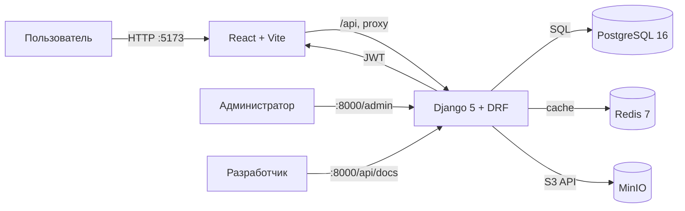

# 05. Архитектура

## 1. Статус

Документ описывает фактическое состояние после завершения backend-части Этапа 3: доменные модели, CRUD API, workflow ревизий, вложения, LLM-заглушка, отчёты/экспорт XLSX и аудит реализованы и покрыты тестами. Frontend-интерфейс планируется отдельным этапом.

## 2. Компоненты



| Сервис | Роль | Порт по умолчанию |
|---|---|---|
| `frontend` | SPA на React, dev-сервер Vite; сейчас базовый каркас и health-блок | 5173 |
| `backend` | REST API, админка, Swagger | 8000 |
| `postgres` | основная БД | 5432 |
| `redis` | кэш; при недоступности API продолжает работать | 6379 |
| `minio` | S3-хранилище вложений | 9000 |
| `minio` console | веб-консоль MinIO | 9001 |
| `minio-init` | одноразовое создание bucket `fmea` через `mc` | — |

## 3. Структура backend

```text
backend/
├── config/
│   ├── settings.py      # конфигурация через переменные окружения
│   ├── urls.py          # маршруты API, админки и Swagger
│   ├── asgi.py
│   └── wsgi.py
├── apps/
│   ├── accounts/        # User, роли, JWT, права
│   ├── core/            # health-check
│   ├── catalog/         # MedicalProduct, ProductVariant, Component
│   └── fmea/            # ревизии, пункты, связи, вложения, подсказки, отчёты, аудит
│       ├── attachments.py
│       ├── audit.py
│       ├── filters.py
│       ├── llm.py
│       ├── reports.py
│       ├── serializers.py
│       ├── services.py
│       ├── views.py
│       └── urls.py
├── manage.py
├── requirements.txt
├── pytest.ini
└── pyproject.toml       # настройки ruff
```

Для XLSX-экспорта используется `openpyxl>=3.1,<4`. PDF-экспорт в MVP не реализован.

## 4. Структура frontend

```text
frontend/
├── src/
│   ├── api/             # axios и типы ответов
│   ├── components/      # общие компоненты
│   ├── pages/           # страницы
│   ├── App.tsx
│   ├── main.tsx
│   └── index.css
├── index.html
├── vite.config.ts
└── package.json
```

Vite проксирует запросы `/api` на backend. В Docker цель прокси — `http://backend:8000`, локально — `http://localhost:8000`.

## 5. Поток запроса

1. Браузер открывает `http://localhost:5173`.
2. Frontend вызывает `/api/...`; Vite проксирует запрос в Django.
3. DRF проверяет JWT, роль и права на объект/статус ревизии.
4. Данные читаются/пишутся в PostgreSQL; файлы — в MinIO через `django-storages`.
5. Изменения фиксируются в `AuditLog` через сервисный слой `log_action`, а не через сигналы моделей.
6. Ответ возвращается в JSON; исключение — XLSX-файл и presigned URL для вложений.

## 6. Аутентификация и роли

- Вход по email и паролю, `POST /api/auth/token/`.
- `access` — 15 минут, `refresh` — 7 дней; в payload добавляются `role`, `email`, `full_name`.
- Роли: `engineer`, `quality`, `admin`.
- Пользователи и роли управляются в Django admin; отдельного users API нет.
- Все прикладные API требуют аутентификации; публичны только health, token, schema/docs.
- Просмотр `/api/audit/` доступен только `admin`.

## 7. Конфигурация

| Переменная | Назначение | Значение по умолчанию |
|---|---|---|
| `DJANGO_SECRET_KEY` | секрет Django | dev-значение |
| `DJANGO_DEBUG` | режим отладки | `true` |
| `DJANGO_ALLOWED_HOSTS` | разрешённые хосты | `localhost,127.0.0.1,backend` |
| `DATABASE_URL` | полный URL БД, приоритетнее `POSTGRES_*` | пусто |
| `POSTGRES_*` | параметры PostgreSQL | `fmea` / dev-пароль |
| `REDIS_URL` | URL Redis; пусто — locmem | пусто |
| `USE_S3` | включить MinIO/S3 | `false` |
| `MINIO_IMAGE` | образ для сервисов `minio` и `minio-init` | `quay.io/minio/minio:latest` |
| `MINIO_*` | доступы, bucket и endpoint | dev-значения |
| `MINIO_PUBLIC_ENDPOINT` | хост, который получает клиент в presigned URL | `http://localhost:9000` |
| `CORS_ALLOWED_ORIGINS` | Origin для CORS | `http://localhost:5173` |
| `CSRF_TRUSTED_ORIGINS` | доверенные Origin | localhost-адреса |
| `VITE_API_URL` | базовый URL API для frontend | `/api` |
| `VITE_PROXY_TARGET` | цель прокси Vite | `http://localhost:8000` |

Секреты задаются в `.env`; в репозитории хранится только `.env.example`. Presigned URL использует `MINIO_PUBLIC_ENDPOINT`, чтобы клиент не получал внутренний адрес `minio:9000`.

## 8. Хранилище и кэш

- **PostgreSQL** — основная БД; локально без Docker допускается SQLite.
- **Redis** — кэш; при недоступности health-check показывает `degraded`, но приложение работает.
- **MinIO** — приватный bucket `fmea`; создание объекта проходит через `django-storages`.
- Вложения: до 20 МБ, whitelist MIME, из него генерируется UUID-ключ, оригинальное имя сохраняется в метаданных.
- `minio-init` использует тот же образ, что и `minio` (в нём доступен `mc`), что позволяет не тянуть отдельный `minio/mc`.

## 9. Health-check

`GET /api/health/` проверяет соединение с БД (`SELECT 1`) и запись/чтение в кэше.

```json
{
  "status": "ok",
  "service": "fmea-backend",
  "version": "0.1.0",
  "checks": {
    "database": "ok",
    "cache": "ok"
  },
  "timestamp": "2026-11-01T14:00:00+00:00"
}
```

При ошибке БД или кэша возвращается `503` и `status: degraded`.

## 10. Docker Compose

Порядок запуска:

1. `postgres`, `redis`, `minio` проходят healthcheck.
2. `minio-init` создаёт bucket `fmea`.
3. `backend` выполняет `migrate` и запускает `runserver`.
4. `frontend` запускает Vite после успешного health-check backend.

Для production потребуется заменить `runserver` на gunicorn, включить `DEBUG=false`, настроить TLS и внешние секреты.

## 11. Принятые решения

| Решение | Причина |
|---|---|
| JWT вместо сессий | SPA и раздельный frontend/backend |
| Кастомный User сразу | Email-логин и роли нужны доменной модели |
| PostgreSQL по умолчанию в Docker | JSONB, ограничения и сортировка RPN |
| SQLite для локального запуска | Быстрый старт без инфраструктуры |
| Vite proxy | Нет CORS-проблем при разработке |
| MinIO через S3 API | Совместимость с облачным хранилищем |
| `minio-init` на том же образе | Меньше образов, нет зависимости от `minio/mc` |
| Redis с `IGNORE_EXCEPTIONS` | Кэш не должен ронять API |
| Аудит через `log_action` | Централизованная санитизация секретов |
| LLM как детерминированная заглушка | Стабильная демонстрация без внешнего провайдера |
| XLSX через openpyxl | Кириллица и отсутствие тяжёлой офисной инфраструктуры |

## 12. Ограничения текущего этапа

- Frontend ещё не содержит страниц каталога, FMEA-таблицы, графа и отчётов.
- Реальная LLM/RAG не подключены; доступен только `stub`.
- PDF-экспорт не реализован.
- Пользователи создаются в Django admin, а не через API/UI.
- Демо-данные анонимизированы и не являются реальной документацией изделия.

## 13. Следующие шаги

1. Frontend: логин, каталог, карточка изделия, FMEA-таблица.
2. Граф зависимостей и отчёты/экспорт в UI.
3. Демонстрационный сценарий по трём ролям.
4. Финальные проверки `make test`, `make lint`, `spectacular --validate`.
