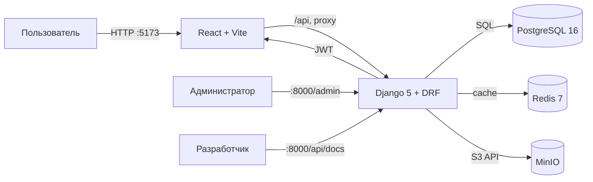

# 05. Архитектура

## 1. Статус

Документ описывает фактическое состояние после шага 2 (каркас проекта). По мере разработки разделы обновляются вместе с кодом.

## 2. Компоненты



| Сервис | Роль | Порт по умолчанию |
|---|---|---|
| `frontend` | SPA на React, dev-сервер Vite | 5173 |
| `backend` | REST API, админка, Swagger | 8000 |
| `postgres` | основная БД | 5432 |
| `redis` | кэш, задел под фоновые задачи | 6379 |
| `minio` | S3-хранилище вложений | 9000 |
| `minio` console | веб-консоль MinIO | 9001 |

## 3. Структура backend

```text
backend/
├── config/
│   ├── settings.py      # конфигурация через переменные окружения
│   ├── urls.py          # маршруты API, админки и Swagger
│   ├── asgi.py
│   └── wsgi.py
├── apps/
│   ├── accounts/        # кастомный User, роли, JWT
│   └── core/            # health-check
├── manage.py
├── requirements.txt
├── pytest.ini
└── pyproject.toml       # настройки ruff
```

На следующих шагах появятся приложения `catalog`, `fmea`, `llm`, `reports`.

## 4. Структура frontend

```text
frontend/
├── src/
│   ├── api/             # axios и типы ответов
│   ├── components/      # общие компоненты
│   ├── pages/           # страницы
│   ├── App.tsx
│   ├── main.tsx
│   └── index.css
├── index.html
├── vite.config.ts
└── package.json
```

Vite проксирует запросы `/api` на backend. В Docker цель прокси — `http://backend:8000`, локально — `http://localhost:8000`.

## 5. Поток запроса

1. Браузер открывает `http://localhost:5173`.
2. Frontend вызывает `/api/...`; Vite проксирует запрос в Django.
3. Django проверяет JWT, права и обрабатывает запрос.
4. Данные читаются/пишутся в PostgreSQL; кэш — в Redis; файлы — в MinIO.
5. Ответ возвращается в формате JSON.

Для health-check цепочка короче: браузер → Vite → `/api/health/` → Django → PostgreSQL + Redis.

## 6. Аутентификация и роли

- Вход по email и паролю.
- `POST /api/auth/token/` возвращает `access`, `refresh` и профиль пользователя.
- Access-токен живёт 15 минут, refresh — 7 дней.
- Роли: `engineer`, `quality`, `admin`.
- По умолчанию все API-эндпоинты требуют аутентификацию; исключение — `/api/health/` и токен-эндпоинты.
- Роль и email добавляются в payload JWT.

## 7. Конфигурация

| Переменная | Назначение | Значение по умолчанию |
|---|---|---|
| `DJANGO_SECRET_KEY` | секрет Django | dev-значение |
| `DJANGO_DEBUG` | режим отладки | `true` |
| `DJANGO_ALLOWED_HOSTS` | разрешённые хосты | `localhost,127.0.0.1,backend` |
| `DATABASE_URL` | полный URL БД, приоритетнее `POSTGRES_*` | пусто |
| `POSTGRES_*` | параметры PostgreSQL | `fmea` / dev-пароль |
| `REDIS_URL` | URL Redis; пусто — локальный кэш | пусто |
| `USE_S3` | включить MinIO/S3 | `false` |
| `MINIO_*` | доступы, bucket и endpoint | dev-значения |
| `CORS_ALLOWED_ORIGINS` | Origin для CORS | `http://localhost:5173` |
| `CSRF_TRUSTED_ORIGINS` | доверенные Origin | localhost-адреса |
| `VITE_API_URL` | базовый URL API для frontend | `/api` |
| `VITE_PROXY_TARGET` | цель прокси Vite | `http://localhost:8000` |

Секреты задаются в `.env`; в репозитории хранится только `.env.example`.

## 8. Хранилище и кэш

- **PostgreSQL** — основная БД; локально без Docker допускается SQLite.
- **Redis** — кэш; при недоступности health-check показывает `degraded`, но приложение продолжает работать.
- **MinIO** — S3-совместимое хранилище для вложений; bucket создаётся сервисом `minio-init`.
- Для подключения S3 используется `django-storages`; публичный доступ к bucket закрыт (bucket приватный).

## 9. Health-check

`GET /api/health/` проверяет:
- соединение с БД (`SELECT 1`);
- запись и чтение в кэше.

Ответ:

```json
{
  "status": "ok",
  "service": "fmea-backend",
  "version": "0.1.0",
  "checks": {
    "database": "ok",
    "cache": "ok"
  },
  "timestamp": "2026-11-01T14:00:00+00:00"
}
```

При ошибке БД или кэша возвращается `503` и `status: degraded`.

## 10. Docker Compose

Порядок запуска:
1. `postgres`, `redis`, `minio` проходят healthcheck.
2. `minio-init` создаёт bucket.
3. `backend` применяет миграции и запускает `runserver`.
4. `frontend` запускает Vite после успешного health-check backend.

Для production потребуется заменить `runserver` на gunicorn, включить `DEBUG=false`, настроить TLS и внешние секреты.

## 11. Принятые решения

| Решение | Причина |
|---|---|
| JWT вместо сессий | SPA и раздельный frontend/backend |
| Кастомный User сразу | Email-логин и роли нужны доменной модели; позже менять `AUTH_USER_MODEL` дорого |
| PostgreSQL по умолчанию в Docker | Ограничения, JSONB и генерируемые поля для FMEA |
| SQLite для локального запуска | Быстрый старт без инфраструктуры |
| Vite proxy | Нет CORS-проблем при разработке |
| MinIO через S3 API | Совместимость с облачным хранилищем и `django-storages` |
| Redis с `IGNORE_EXCEPTIONS` | Кэш не должен ронять API |

## 12. Ограничения текущего этапа

- Доменные модели FMEA ещё не реализованы.
- Нет страниц входа, списка изделий, FMEA-таблицы, графа и отчётов.
- Нет загрузки вложений и LLM-заглушки.
- Swagger содержит только health и auth.
- `make seed` пока не работает: команда появится на шаге 3.
- PDF-экспорт и кириллические шрифты не настроены.

## 13. Следующие шаги

1. Доменные модели и миграции.
2. Админка и `seed_demo` по данным ТЕВЛАР.
3. CRUD API изделий, компонентов и ревизий.
4. FMEA-таблица, граф и отчёты.
5. LLM-заглушка и применение предложений.
6. Тесты, документация и демонстрационный сценарий.
